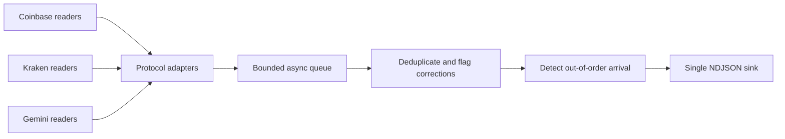

# Market Data WebSocket Pool

A Python service for collecting public crypto trades from **Coinbase Exchange, Kraken, and Gemini** into one normalized event stream.

Built by [Andrii Trush](https://github.com/andrymt) as an original portfolio project exploring exchange-data ingestion and operational reliability. This is new, independently written code, not a publication of an employer's system or a claim of historical production deployment.

## What it demonstrates

- Exchange-specific adapters behind one consistent trade schema.
- Optional redundant connections to the same feeds, merged through a bounded queue.
- Subscription acknowledgement, reconnect with capped jittered backoff, WebSocket keepalives, and application-message silence timeouts.
- Bounded, time-limited duplicate suppression across redundant readers and reconnects.
- Changed payloads for an existing trade ID surfaced as `trade_correction` events.
- Late/out-of-order trades retained and flagged rather than silently discarded.
- Decimal prices and quantities preserved as strings; nanosecond timestamps retained as integers.
- Explicit `continuity_risk` records after disconnects, plus operational counters and feed ages.
- A single asynchronous sink with backpressure, cancellation, and bounded shutdown draining.
- Offline protocol and failure-mode tests; CI on Python 3.11, 3.12, and 3.13.

## Run in two minutes

Python 3.11+ is required. No exchange accounts, API keys, or trading permissions are needed.

```sh
python -m venv .venv
source .venv/bin/activate
python -m pip install -e '.[dev]'

# Collect BTC/USD and ETH/USD from all three exchanges for one minute.
market-pool --duration 60

# Keep an append-only local capture; records remain private on your machine.
market-pool --duration 60 --output trades.jsonl

# Two redundant connections per exchange, deduplicated in the consumer.
market-pool --copies 2 --symbols BTC-USD --duration 60

# Select a subset of exchanges and tune the silence timeout.
market-pool --exchanges coinbase kraken --read-timeout 90 --duration 30
```

Prices, quantities and symbol availability are exchange-specific. `BASE-QUOTE` is the canonical configuration format; e.g. `BTC-USD` maps to `BTC/USD` on Kraken and `btcusd` on Gemini. Validate venue support before adding other pairs. Two connections are an explicit opt-in, not a recommendation to bypass exchange limits.

The CLI writes trade/correction/continuity records to stdout or `--output`. Status snapshots and logs go to stderr. Redirect both separately if needed. A status snapshot is emitted every ten seconds and at exit. `Ctrl+C`, `SIGTERM`, or `--duration` stops readers and drains accepted records, up to ten seconds.

```sh
market-pool --duration 30 > trades.jsonl 2> collector.log
```

## Event contract

Illustrative normalized event (not a claimed live capture):

```json
{
  "type": "trade",
  "exchange": "coinbase",
  "symbol": "BTC-USD",
  "trade_id": "42",
  "price": "90000.00000001",
  "quantity": "0.01000000",
  "taker_side": "sell",
  "event_time_ns": 1760013000123456789,
  "received_time_ns": 1760013000223456789,
  "out_of_order": false
}
```

`event_time_ns` is the venue's event time; `received_time_ns` is the local wall-clock timestamp taken immediately after `recv()`. Their difference includes clock skew and network/runtime delay; it is **not** an independently measured exchange latency. Monotonic time is used for timeouts and dedup expiration.

Coinbase reports maker side in match messages, so its adapter inverts the value. Kraken already reports taker side. Gemini's buyer-maker boolean is converted to taker side. Initial `last_match`/trade snapshots are not emitted as newly executed trades.

A `trade_correction` contains the same fields as a trade and replaces that identity's previously emitted payload. `out_of_order` compares event time with that exchange/symbol's accepted high-water timestamp. Consumers should upsert on `(exchange, symbol, trade_id)` and handle corrections explicitly.

## Architecture



Adapters own subscription payloads, acknowledgement semantics, wire symbols, validation and normalization. The pool owns socket lifecycle, flow control and retries. A single consumer owns deduplication and event-time high-water marks, avoiding shared mutable state across readers. File writes run in a worker thread and are awaited serially; disk latency does not block the asyncio event loop.

The default dedup cache holds at most 50,000 identities for five minutes, measured from first accepted arrival. It is process-local. A conflicting duplicate updates the cached signature and emits a correction without extending the original expiration time. Numeric strings preserve source formatting; equivalent values with different formatting can therefore produce a conservative correction.

## Delivery limits and recovery boundaries

This project favors visible failure over claims of completeness:

- Redundant sockets reduce exposure to an individual connection outage, but are not independent exchange feeds and do not prove gap-free delivery.
- Disconnects, rejected subscriptions, malformed recognized payloads and silence timeouts produce `continuity_risk` records. That is a recovery signal, not proof that trades were lost or a calculated missing interval.
- Reconnect resubscribes to live updates. **Historical REST backfill, sequence-gap reconciliation, durable deduplication, rolling-window index recalculation and replay are not implemented.** They are deliberate next layers, with venue-specific pagination and correction rules.
- In-memory deduplication is bounded. After eviction, expiry or restart, duplicates may be emitted again. No exactly-once delivery guarantee is made.
- Queue backpressure eventually reaches the socket buffers. A sufficiently slow consumer may cause venue disconnects. The service never silently drops trades to hide overload.
- Status distinguishes subscription state, application-message age and last accepted trade age. A live heartbeat does not mean a market has traded recently. Quiet markets may need a larger `--read-timeout`.
- NDJSON is append-and-flush, not a transactional/fsync durability guarantee. Sink failure stops the process. Shutdown exceeding the drain deadline fails rather than claiming all records were written.
- No order-book reconstruction, order placement, private feeds or exchange-account access is included.

## Test and build

```sh
python -m unittest discover -s tests -v
ruff check src tests
ruff format --check src tests
python -m build
```

Tests are offline and deterministic except for bounded scheduling waits in asynchronous tests. They cover protocol normalization, decimal/timestamp precision, maker/taker semantics, acknowledgements, malformed payloads, duplicates, corrections, late arrival, TTL/capacity eviction, backoff bounds, silent connections, reconnect/resubscribe, redundant readers, backpressure and sink failure. Live exchange calls are deliberately excluded from CI.

Container option:

```sh
docker build -t market-pool .
docker run --rm market-pool --symbols BTC-USD --duration 30
```

## Protocol references

Implementation references checked in October 2026:

- [Coinbase Exchange WebSocket overview](https://docs.cdp.coinbase.com/exchange/websocket-feed/overview) and [channels](https://docs.cdp.coinbase.com/exchange/websocket-feed/channels).
- [Kraken WebSocket v2 trade feed](https://docs.kraken.com/exchange/api-reference/spot-websocket-v2/trade).
- [Gemini WebSocket introduction](https://developer.gemini.com/websocket/introduction), [trade stream](https://developer.gemini.com/websocket/streams#trade-stream), and [subscription playground](https://developer.gemini.com/websocket/playground#method-subscribe).
- [websockets 15.0.1 asyncio client](https://websockets.readthedocs.io/en/15.0.1/reference/asyncio/client.html).

Gemini uses its current `wss://ws.gemini.com` stream API, not the older market-data v1/v2 endpoint. The dependency is pinned to the tested client version. Public access is subject to the exchanges' availability, terms and rate limits; no captured market-data files are bundled.

## License

MIT for the source code. Exchange data rights remain with their respective providers.

## Local verification

Checked on Python 3.12 on October 21, 2026:

- 24 offline tests passed; lint and formatting checks passed.
- A 30-second public-feed smoke run received 239 normalized trades across all three exchanges and both configured symbols.
- A separate 15-second redundant-reader run received 176 trade messages, emitted 88 unique trades, and suppressed 88 duplicates.
- Source and wheel distributions built, and the installed wheel's CLI and tests were verified.

These are functional smoke checks, not throughput or latency benchmarks. Results vary with market activity and network conditions. Docker and the CI matrix are provided but were not executed locally.
